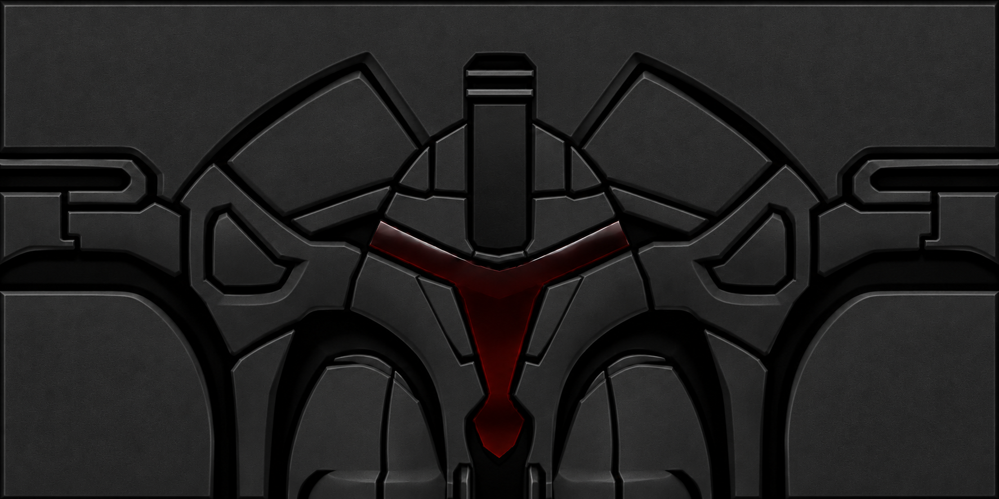

# AO Armor Packs

Optional local armor artwork and live switching for the regular Anarchy Online
new-engine client, with integration for the [AOU mod](https://github.com/zooraw/aou_mod).

**[Download the latest release](https://github.com/zooraw/ao-armor-packs/releases/latest)**
and follow the **[installation guide](INSTALL.md)** or **[AI installation guide](INSTALL_WITH_AI.md)**.
Python 3.13 or 3.14 is required. The ZIP includes the installer and custom artwork;
Git is not needed.

The included Omni-Armed Forces pack has a matte charcoal/black helmet and body,
a dark blood-red glass visor/logos, and a black/yellow worn Tank Armor. Helmet/body
and tank have independent switches. The helmet has no yellow.



## Installation and controls

Close regular AO normally, then run:

```powershell
.\Install.ps1 -GamePath 'C:\Games\Anarchy Online' -GuiPath 'C:\LocalPrefs\Gui' -PreferencesPath 'C:\LocalPrefs\Prefs\Account\Prefs.xml'
```

`GuiPath` is the directory containing `AOU_CYT`, `AOU_Slim_CNI` and/or `AOU_Slim_CNT`.
Use the exact account's `Prefs.xml`. The guide helps an assistant find these
without collecting passwords. Keep real values in your local command/shortcut.

Use the **AO Armor Packs** desktop shortcut, then **AOU > Armor Packs** or
**F10 > Armor Packs**. Checked / `[x]` selects custom art; unchecked / `[ ]`
selects stock art. With the companion running, changes appear in the current
game session. Item stats and server data are unchanged. Shared texture IDs affect
other items/characters using those textures on this client.

**The base AOU mod has no armor controls.** This separate installer adds them
only after verifying the pack, its sources and the client-native database reads.
Uninstall removes them. `-StartWithWindows` optionally starts only the companion
at Windows sign-in; otherwise the desktop shortcut starts it. An existing game
is preserved when starting the companion.

## What installation changes

- Creates an isolated Python environment and private state under
  `%USERPROFILE%\.ao-armor-packs`, outside this repository.
- Checks exact client DLL hashes; unsupported builds fail before database edits.
- Extracts stock art locally, prepares matching stock/custom DXT1 sources, appends
  stock-HD records and updates the eight index pointers and native EOF markers.
  Custom art is applied to existing GPU textures by the local companion.
- Uses the client's read-only native database reader to verify the selected HD
  baseline, then adds owned XML blocks/help to supported installed AOU layouts.
- Creates a desktop shortcut and, if requested, an owned Startup shortcut.

Original game resources, account configuration, generated DDS, database backups
and logs stay local. This repo ships custom PNG artwork and source, not original
game texture records or executable binaries. No credentials, authentication
automation, server changes, network listener or Windows service are involved.

Rerunning the same install verifies the owned files and repairs the optional GUI
integration without appending records again. Keep the repository at the chosen
location because shortcuts run its source. Re-run installation after updating
or reinstalling AOU to restore the optional integration.

## Removal, status and compatibility

```powershell
.\Start-ArmorPacks.ps1 -Stop
.\Uninstall.ps1
```

Close AO before removal when this installer created database allocations.
Uninstall restores the owned pre-install database checkpoint and removes the
armor controls/shortcuts. It refuses if another tool or game update has changed
owned database bytes. Private backups remain available for review.

The companion status file is `%USERPROFILE%\.ao-armor-packs\controller-status.json`.
`waiting-for-game` / `waiting-for-armor` is normal before the game/resources load.
For custom state locations, pass the same `-StateDirectory` to all scripts.

This first version targets the verified 32-bit regular-AO 18.8.62_EP2 new-engine
DLL build. It does not target Project Rubi-Ka. See [verification](docs/verification.md)
for observed behavior and remaining coverage. Cached staging uploads explicitly
mark their source dirty before **every** transfer, including off/rollback paths.

## Development and credits

Run `python -m unittest discover -s tests -v` after installing requirements.
See [AGENTS.md](AGENTS.md) for contribution, verification and privacy rules.
Code is GPL-3.0-only; the read-only RDB parser is adapted from the format work in
[TheTinkeringIdiot/TinkerParse](https://github.com/TheTinkeringIdiot/TinkerParse)
and modified for explicit paths, validation and installation ownership.
AOU/dracul89 and Funcom retain their respective upstream/game rights.
Custom artwork was AI-assisted and refined from game armor layouts; this package
does not claim ownership of Funcom's underlying armor designs or trademarks.
